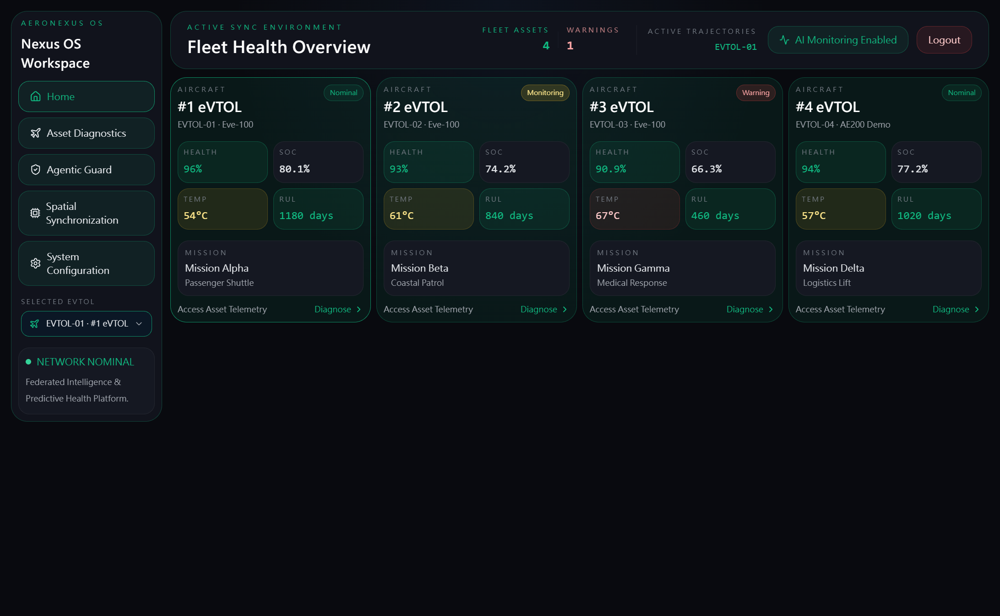
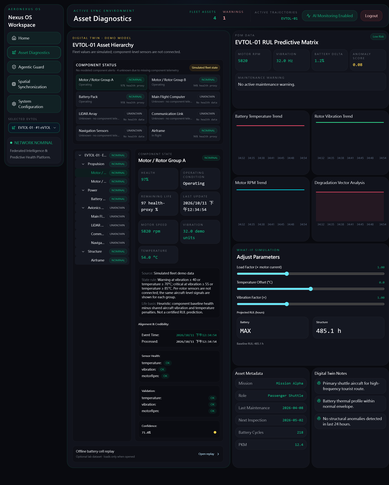
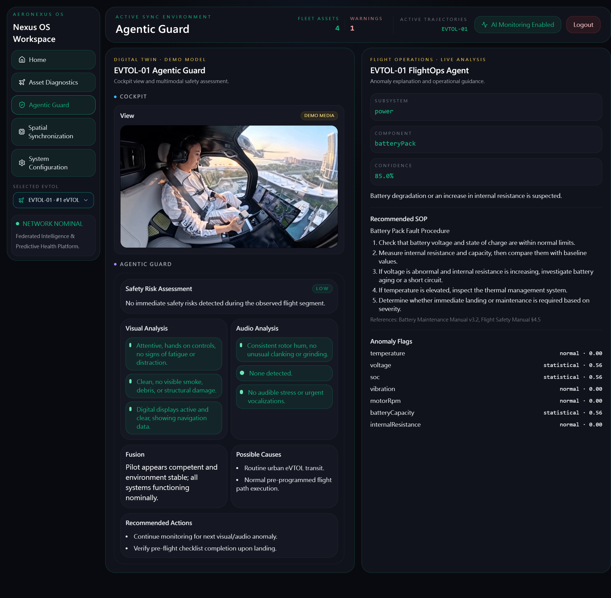
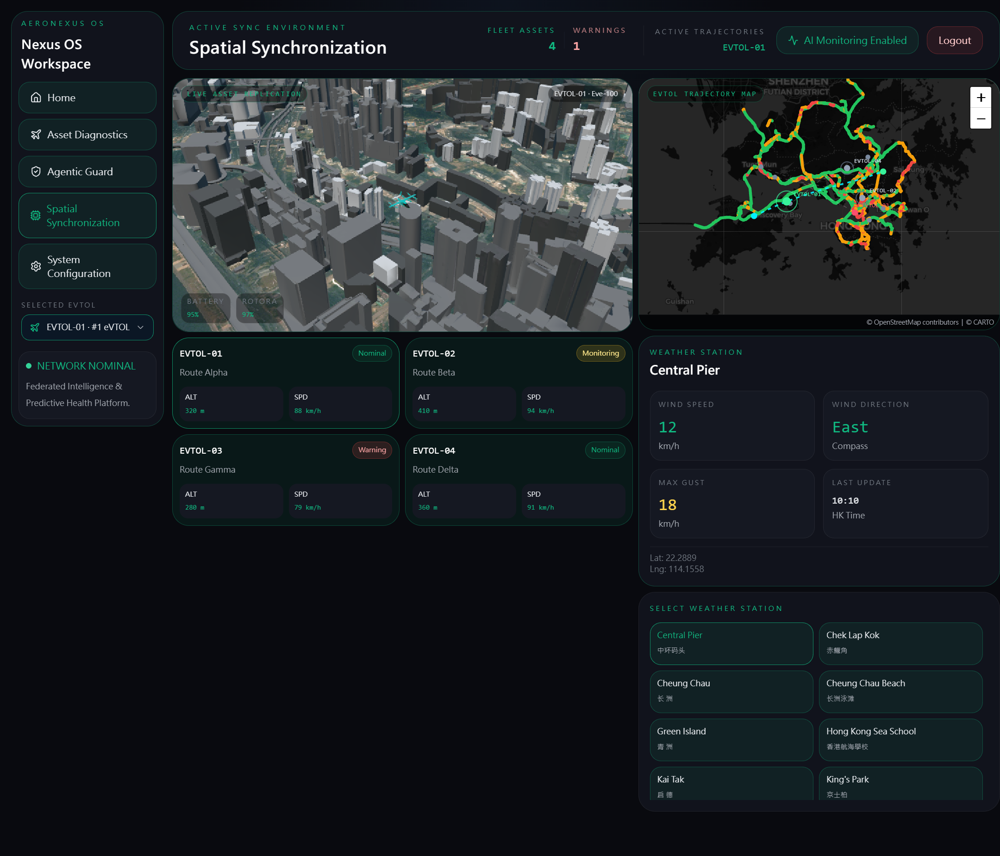
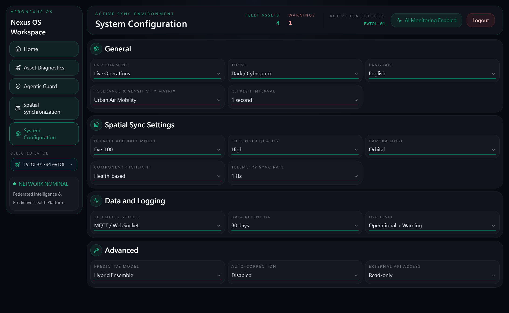

<div align="center">

# AERONEXUS OS

### An operator-focused eVTOL fleet and Digital Twin prototype

Digital Twin development, fleet health, asset diagnostics, geospatial context, and safety workflows in one interactive showcase.

[Source application](https://github.com/HenryyyW/AeroNexus-OS) · [Showcase repository](https://github.com/HenryyyW/AeroNexus-OS-showcase)

</div>

> **Project status:** production-minded prototype, not a production flight-operations system. The interface demonstrates an end-to-end operator workflow and engineering direction; data, models, authentication, and operational integrations are not certified or ready for aircraft use.

## Overview

AeroNexus OS explores how an urban air-mobility team could review fleet condition, investigate an aircraft, understand its city context, and consult structured safety information from a single workspace. The showcase is built around connected operator-facing surfaces: fleet overview, Digital Twin, component diagnostics, safety review, and configuration.

Digital Twin is a significant development area in AeroNexus OS, not just a 3D aircraft viewer. The implementation includes an inspectable aircraft-to-subsystem-to-component asset model, component-level condition and alert logic, provenance and validation details, and a geospatial workspace combining Cesium, Leaflet, route playback, and weather context. These operator workflows are backed by reusable React views and diagnostic logic, while aircraft state remains simulated and is not synchronized to a live aircraft or authoritative digital-twin backend.

## Digital Twin Development

The twin work connects operational context to a structured asset model:

- **Hierarchical asset representation:** aircraft records expand into propulsion, power, avionics and sensors, and structure, with inspectable component nodes such as motor/rotor groups, battery pack, flight computer, LiDAR, navigation sensors, and airframe. Stable asset and parent identifiers support navigation through the hierarchy.
- **Component-level condition model:** components expose operating state, metrics, health proxies, alert levels, and remaining-life basis. Subsystem and aircraft views aggregate available health, highest-severity alerts, sensor validation, and anomaly flags.
- **Data credibility in the UI:** asset details can show source and evaluation method, event and processing times, sensor health, validation results, and confidence. Missing component telemetry is represented as unknown rather than presented as a measured healthy state.
- **Spatial twin context:** a Cesium aircraft scene sits alongside a Leaflet fleet map, route playback, road context, and selectable Hong Kong weather stations, bringing asset and environmental context into the same operator workflow.

These are implemented Digital Twin foundations, not a claim of a validated real-time twin. Fleet and component values are demo/simulated; some component states use heuristics over shared aircraft-level signals, while other component telemetry is intentionally unknown. 3D playback and map routes are illustrative and are not guaranteed to represent the same live position. No aircraft connection, authoritative state synchronization service, or validated physical model is included.

## Product Showcase

### Fleet Health

The fleet overview brings aircraft status, health indicators, state of charge, temperature, mission context, and maintenance signals into a status-first view. Fleet readings and flight context currently originate from seeded example data and a local simulation, not connected aircraft.



### Asset Diagnostics

The diagnostics workspace organizes battery, rotor, avionics, and sensor indicators alongside time-series trends, anomaly scores, and maintenance context. The prototype includes input-range validation and experimental rule/statistical analysis to make the diagnostic path inspectable. Its warnings and remaining-life figures are demonstrative outputs, not maintenance instructions or validated prognostics.



### Safety Review

The safety surface presents a structured review format for risk level, visual/audio observations, possible causes, and recommended follow-up. Current assessments are example content loaded with the aircraft data; no production computer-vision, audio, or multimodal inference service is connected.



### Spatial Operations

The spatial workspace pairs the Cesium 3D aircraft presentation with an interactive 2D fleet map, route playback, and environmental context. Road-speed context can use a public Hong Kong traffic feed in the local Vite development setup; weather observations are requested from selectable stations. Aircraft positions and routes remain illustrative demo trajectories, not a shared live track. External map tiles, feeds, and optional road-network KML files require network access and local setup.



### Configuration

Configuration controls expose the kinds of choices an operations product needs to make explicit, including display, map, telemetry, retention, and model options. In this prototype, selections are stored in browser local storage and do not configure a live service, data pipeline, or model deployment.



## What Works in This Prototype

| Area | Implemented in the showcase | Boundary today |
| --- | --- | --- |
| Operator workflow | Fleet overview, selected-aircraft context, diagnostics, safety review, and settings views. | Demonstration workflow; no dispatch or aircraft-control commands. |
| Digital Twin | Hierarchical aircraft/subsystem/component model; component condition and alert logic; source, method, sensor validation, confidence, and unknown-state presentation; Cesium and Leaflet spatial context. | Seeded/simulated state, heuristic proxies, and illustrative playback; no live aircraft sync or validated physical twin. |
| Fleet state | Seeded eVTOL records with locally simulated telemetry updates and predefined routes. | No live aircraft, certified sensor feed, or authoritative fleet record. |
| Diagnostics | Sensor-range checks, anomaly indicators, trend displays, and rule/statistical analysis. | Experimental logic; not validated for safety-critical decisions or maintenance planning. |
| Battery analysis | Offline replay and exploratory remaining-life calculations are available in the source application. | The included LFP cell dataset is not an eVTOL battery pack; estimates are not certified SOH/RUL. |
| Geospatial view | Leaflet map overlays, route playback, selectable weather stations, and Cesium 3D visualization. | External map/feed availability varies; aircraft trajectories are examples and are not position-synchronized. |
| Safety review | Structured assessment presentation with example observations and recommendations. | No connected production AI inference or verified cockpit evidence pipeline. |
| Configuration and access | Browser-persisted preferences and a demonstration sign-in screen. | No server-side identity, authorization, audit trail, or operational configuration backend. |

## Run the Application

The showcase repository contains this README and its screenshots. To run the interactive application, use the source repository:

```bash
git clone https://github.com/HenryyyW/AeroNexus-OS.git
cd AeroNexus-OS
npm install
npm run dev
```

The application uses Vite, React, and Node.js. Some spatial layers need network access; the strategic road overlay may also require the external KML files described in the source repository's README. Firebase configuration is optional for the frontend and must be supplied locally where needed. Never commit service-account credentials.

## Production Readiness

This project is intended to communicate a product direction and demonstrate an integrated, operator-oriented interface. Before any operational use, it would need, at minimum, authenticated and authorized services, verified aircraft data integrations, traceable data provenance, validated prognostic models, robust failure handling and observability, security and privacy review, and formal aviation safety assurance. None of those are claimed by this showcase.
